# Serveur BTS 2026

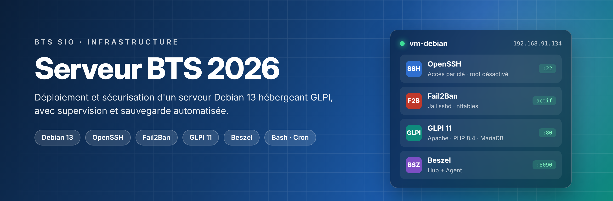

> Déploiement d'un serveur **Debian 13** virtualisé hébergeant l'application de gestion de parc et d'assistance **GLPI**, avec un accès **SSH** durci par clé, une protection contre le brute-force par **Fail2Ban**, une supervision **Beszel** et une **sauvegarde automatisée** (scripts Bash + crontab) vers un hébergement distant InfinityFree.

---

## Sommaire

- [Introduction](#introduction)
- [Architecture](#architecture)
- [Configuration de la machine virtuelle](#configuration-de-la-machine-virtuelle)
- [Technologies utilisées](#technologies-utilisées)
- [1. Installation de Debian](#1-installation-de-debian)
- [2. SSH — authentification par clé](#2-ssh--authentification-par-clé)
- [3. Fail2Ban — protection de SSHD](#3-fail2ban--protection-de-sshd)
- [4. GLPI — Apache, MariaDB et PHP](#4-glpi--apache-mariadb-et-php)
- [5. Beszel — supervision](#5-beszel--supervision)
- [6. Sauvegarde automatisée](#6-sauvegarde-automatisée)
- [7. Planification avec crontab](#7-planification-avec-crontab)
- [Vérifications](#vérifications)
- [Sécurité](#sécurité)
- [Difficultés rencontrées](#difficultés-rencontrées)
- [Perspectives d'évolution](#perspectives-dévolution)
- [Arborescence du dépôt](#arborescence-du-dépôt)
- [Conclusion](#conclusion)

---

## Introduction

Ce projet consiste à mettre en place, à partir d'une installation Debian vierge, un **serveur prêt pour la production** dans le cadre du BTS SIO. Le serveur héberge **GLPI**, l'outil de référence pour l'inventaire du parc informatique et la gestion des tickets d'assistance (helpdesk, bonnes pratiques ITIL).

Autour de l'application, plusieurs services assurent la sécurité et la continuité :

| Besoin | Service mis en place |
| --- | --- |
| **Administrer le serveur à distance** | OpenSSH, authentification par clé uniquement |
| **Bloquer les attaques par force brute** | Fail2Ban, bannissement automatique via nftables |
| **Gérer le parc et les incidents** | GLPI 11 sur une pile Apache 2 + PHP 8.4 + MariaDB 11.8 |
| **Surveiller l'état du serveur** | Beszel (Hub + Agent) : CPU, mémoire, disque, réseau, services |
| **Protéger les données** | Scripts Bash de sauvegarde, planifiés par crontab, envoi FTP hors site |

Chaque étape suit les bonnes pratiques : principe du moindre privilège, séparation des données et du code, fichiers de configuration dédiés plutôt que modification des fichiers d'origine, et aucun secret écrit en clair dans les scripts publiés.

---

## Architecture

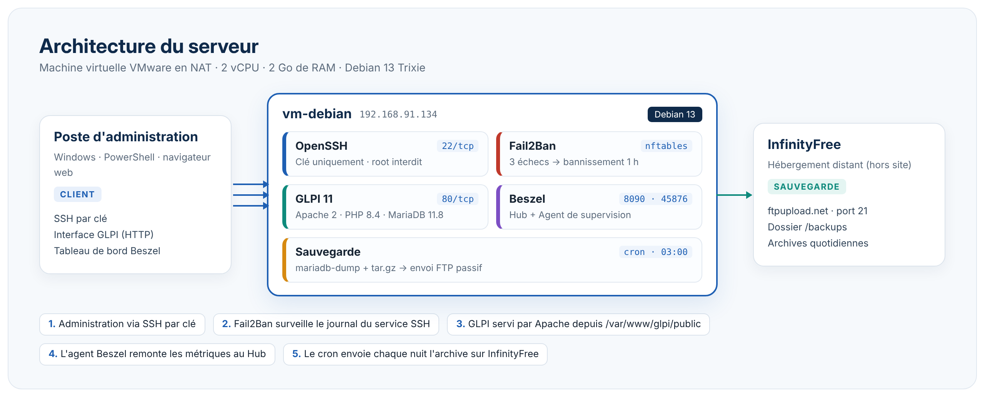

| Flux | Source → Destination | Port |
| --- | --- | --- |
| Administration | Poste d'administration → VM | `22/tcp` (SSH) |
| Application GLPI | Navigateur → Apache | `80/tcp` (HTTP) |
| Supervision | Navigateur → Hub Beszel | `8090/tcp` |
| Remontée des métriques | Hub Beszel ↔ Agent Beszel | `45876/tcp` |
| Sauvegarde | VM → `ftpupload.net` (InfinityFree) | `21/tcp` (FTP passif) |

---

## Configuration de la machine virtuelle

| Paramètre | Valeur |
| --- | --- |
| **Hyperviseur** | VMware Workstation |
| **Système invité** | Debian GNU/Linux 13 « Trixie » (netinst, sans environnement graphique) |
| **Processeurs** | 2 processeurs × 1 cœur |
| **Mémoire** | 2 Go |
| **Réseau** | NAT (`ens33` — `192.168.91.134`, passerelle VMware `192.168.91.2`) |
| **Nom d'hôte** | `vm-debian` |
| **Compte d'administration** | `user` (membre du groupe `sudo`) |
| **Intégration** | `open-vm-tools` (arrêt propre, synchronisation de l'heure) |

> **Pourquoi le mode NAT ?** La VM obtient son adresse auprès du DHCP de VMware et accède à Internet via le poste hôte. L'hôte reste capable de la joindre en SSH et en HTTP, et la configuration fonctionne à l'identique quel que soit le réseau physique (domicile, établissement).

---

## Technologies utilisées

| Outil | Version | Rôle |
| --- | --- | --- |
| **Debian** | 13 Trixie | Système d'exploitation du serveur |
| **OpenSSH** | 10 | Accès d'administration chiffré |
| **Fail2Ban** + **nftables** | 1.1 | Détection et blocage des tentatives d'intrusion |
| **Apache 2** | 2.4 | Serveur web |
| **PHP** | 8.4 | Exécution de GLPI |
| **MariaDB** | 11.8 | Base de données de GLPI |
| **GLPI** | 11.0.12 | Gestion de parc et helpdesk |
| **Beszel** | 0.21 | Supervision légère (Hub + Agent) |
| **Bash**, **tar**, **ftp**, **cron** | — | Sauvegarde automatisée |

---

## 1. Installation de Debian

Installation à partir de l'image `debian-13-netinst`, en mode texte. Seuls les composants **serveur SSH** et **utilitaires usuels du système** sont sélectionnés : aucun environnement de bureau, pour réduire la surface d'attaque et la consommation de ressources.

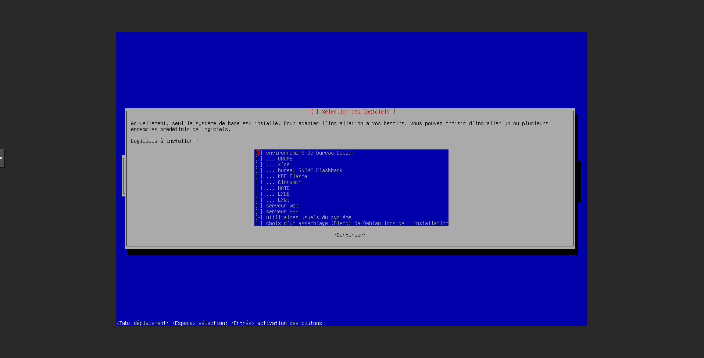

Mise à jour du système et outils de base :

```bash
su -
apt update && apt full-upgrade -y
apt install -y sudo curl wget nano open-vm-tools
usermod -aG sudo user
```

| Commande | Rôle |
| --- | --- |
| `apt update` / `full-upgrade` | Rafraîchit la liste des paquets et applique toutes les mises à jour, y compris de sécurité |
| `open-vm-tools` | Intégration VMware : arrêt propre, synchronisation de l'heure, remontée de l'IP |
| `usermod -aG sudo user` | Donne au compte `user` les droits d'administration via `sudo` |

---

## 2. SSH — authentification par clé

### Génération et copie de la clé (poste Windows, PowerShell)

```powershell
ssh-keygen
type $env:USERPROFILE\.ssh\<nom_de_la_cle>.pub | ssh user@192.168.91.134 "mkdir -p ~/.ssh && chmod 700 ~/.ssh && cat >> ~/.ssh/authorized_keys && chmod 600 ~/.ssh/authorized_keys"
```

`ssh-keygen` crée une paire de clés : la **clé privée** reste sur le poste et n'est jamais partagée, la **clé publique** est ajoutée au fichier `authorized_keys` du serveur, avec les droits stricts exigés par SSH (`700` sur le dossier, `600` sur le fichier).

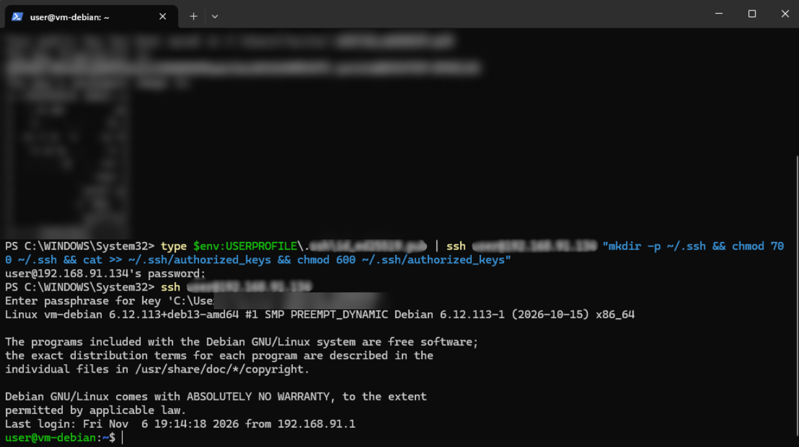

La passphrase de la clé est mémorisée par l'agent SSH de Windows :

```powershell
Get-Service ssh-agent | Set-Service -StartupType Automatic
Start-Service ssh-agent
ssh-add
```

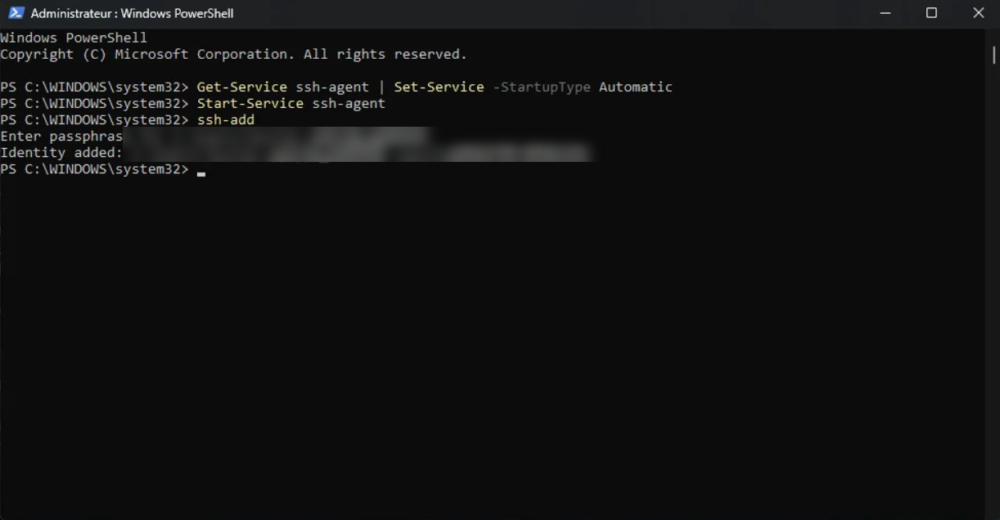

### Durcissement du serveur

Les réglages sont placés dans un fichier dédié, [`Config/ssh/99-hardening.conf`](./Config/ssh/99-hardening.conf), chargé automatiquement depuis `/etc/ssh/sshd_config.d/` : le fichier d'origine n'est jamais modifié.

```
PermitRootLogin no
PasswordAuthentication no
KbdInteractiveAuthentication no
PubkeyAuthentication yes
AllowUsers user
MaxAuthTries 3
LoginGraceTime 30
X11Forwarding no
ClientAliveInterval 300
ClientAliveCountMax 2
```

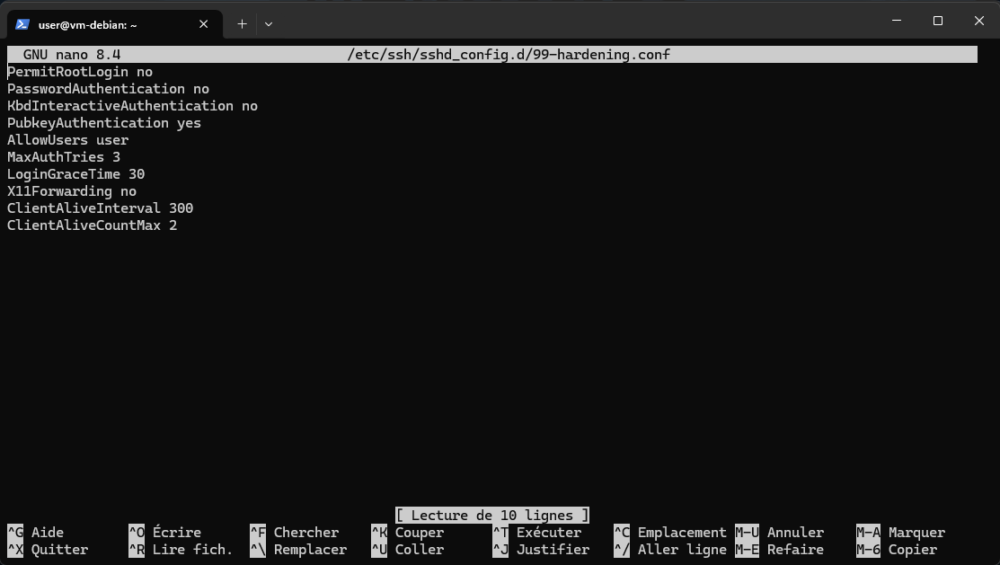

| Directive | Effet |
| --- | --- |
| `PermitRootLogin no` | Le compte root, cible n°1 des attaques, ne peut pas se connecter en SSH |
| `PasswordAuthentication no` | Seule la clé est acceptée : le brute-force de mot de passe devient inopérant |
| `KbdInteractiveAuthentication no` | Ferme la seconde méthode de saisie de mot de passe |
| `AllowUsers user` | Liste blanche des comptes autorisés |
| `MaxAuthTries 3` / `LoginGraceTime 30` | 3 essais par connexion, 30 secondes pour s'authentifier |
| `X11Forwarding no` | Désactive une fonction graphique inutile sur un serveur |
| `ClientAliveInterval` / `CountMax` | Coupe les sessions inactives après environ 10 minutes |

```bash
sudo sshd -t && sudo systemctl restart ssh
sudo sshd -T | grep -Ei 'permitrootlogin|passwordauthentication|allowusers'
```

`sshd -t` valide la syntaxe avant le redémarrage ; `sshd -T` affiche la configuration réellement appliquée.

---

## 3. Fail2Ban — protection de SSHD

Fail2Ban lit le journal du service SSH et bannit temporairement, au niveau du pare-feu, toute adresse IP qui accumule les échecs d'authentification.

```bash
sudo apt install -y fail2ban python3-systemd nftables
```

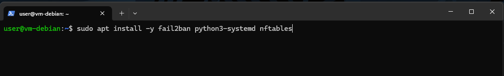

Configuration dans [`Config/fail2ban/jail.local`](./Config/fail2ban/jail.local) :

```ini
[DEFAULT]
bantime   = 1h
findtime  = 10m
maxretry  = 3
backend   = systemd
banaction = nftables-multiport
ignoreip  = 127.0.0.1/8 ::1

[sshd]
enabled      = true
port         = ssh
journalmatch = _SYSTEMD_UNIT=ssh.service
```

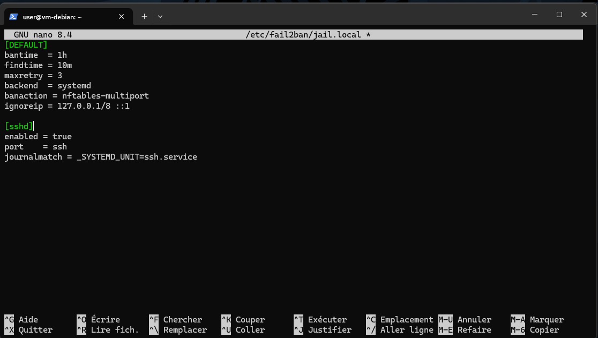

| Paramètre | Rôle |
| --- | --- |
| `maxretry` + `findtime` + `bantime` | 3 échecs en 10 minutes entraînent un bannissement d'une heure |
| `backend = systemd` | Debian 13 n'utilise plus `/var/log/auth.log` : lecture du journal systemd |
| `banaction = nftables-multiport` | Le blocage est appliqué par le pare-feu nftables |
| `journalmatch` | Sous OpenSSH 10, les échecs sont journalisés par `sshd-session` : le filtre surveille tout `ssh.service` |
| `jail.local` | Surcharge `jail.conf` sans le modifier |

```bash
sudo systemctl enable --now fail2ban
sudo fail2ban-client status sshd
```

### Test de bannissement

Quatre tentatives de connexion en root depuis le poste d'administration : les trois premières sont refusées par SSH, puis le port ne répond plus.

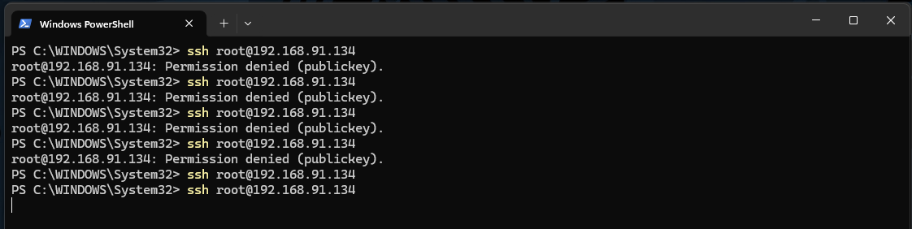

```bash
sudo fail2ban-client status sshd
sudo nft list ruleset | grep -A3 f2b
sudo fail2ban-client set sshd unbanip 192.168.91.1
```

L'adresse du poste (`192.168.91.1`, côté NAT VMware) apparaît dans la liste des IP bannies, et une règle `reject` sur le port 22 est créée dans nftables.

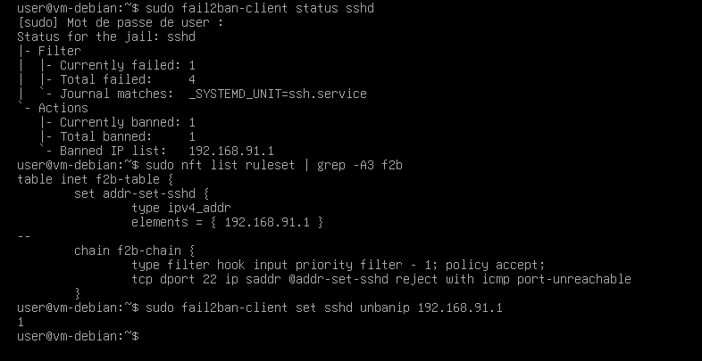

---

## 4. GLPI — Apache, MariaDB et PHP

### Pile LAMP

```bash
sudo apt install -y apache2 mariadb-server php libapache2-mod-php \
  php-{mysql,mbstring,curl,gd,xml,intl,ldap,apcu,zip,bz2,bcmath}
```

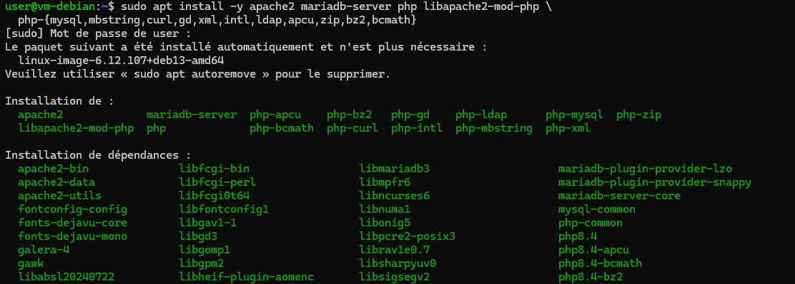

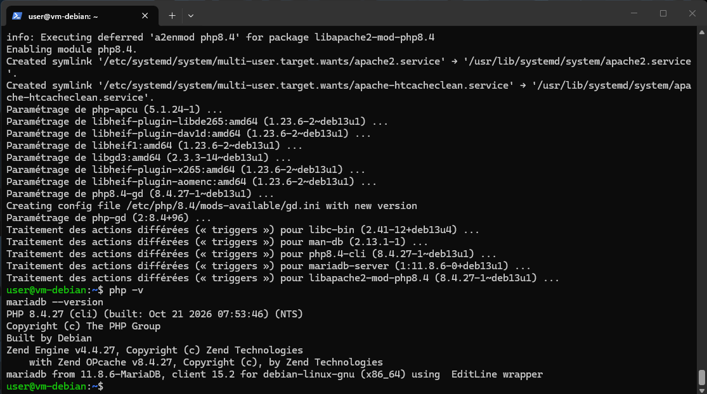

### Base de données

```bash
sudo mariadb-secure-installation
sudo mariadb-tzinfo-to-sql /usr/share/zoneinfo | sudo mariadb mysql
sudo mariadb < Config/glpi/creation-base.sql
```

`mariadb-secure-installation` supprime les comptes anonymes, la base de test et l'accès root distant. Les fuseaux horaires sont chargés car GLPI les exige. Le script [`creation-base.sql`](./Config/glpi/creation-base.sql) crée la base `glpi` (UTF-8 complet) et un **utilisateur dédié**, limité à sa propre base et à une connexion locale : principe du **moindre privilège**.

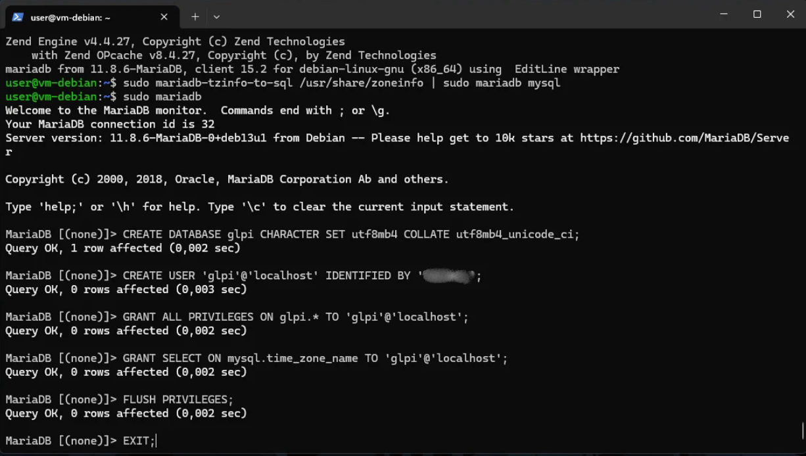

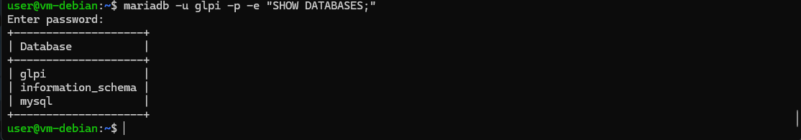

### Installation de GLPI

```bash
cd /tmp
wget https://github.com/glpi-project/glpi/releases/download/11.0.12/glpi-11.0.12.tgz
sudo tar -xzf glpi-11.0.12.tgz -C /var/www/
sudo mv /var/www/glpi/config /etc/glpi
sudo mv /var/www/glpi/files  /var/lib/glpi
sudo mkdir -p /var/log/glpi
sudo chown -R www-data:www-data /var/www/glpi /etc/glpi /var/lib/glpi /var/log/glpi
```

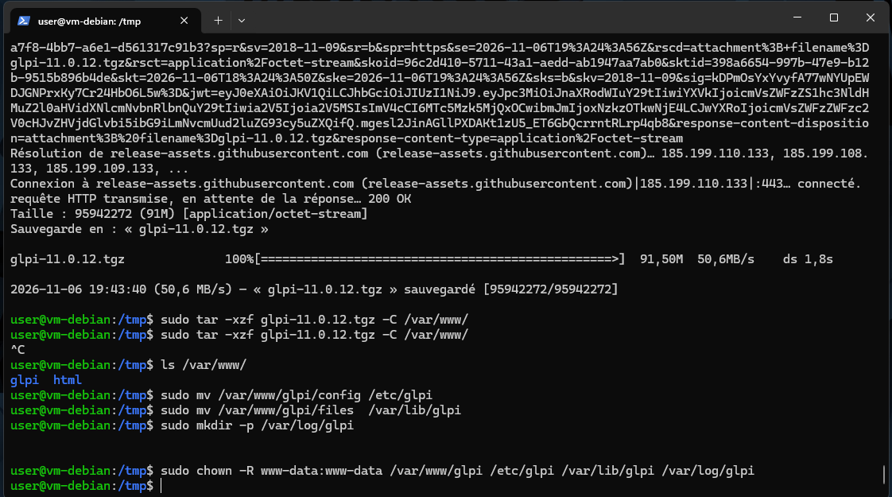

La configuration, les données et les journaux sont **déplacés hors du dossier web**, comme le recommande la documentation de GLPI :

| Dossier | Contenu |
| --- | --- |
| `/var/www/glpi` | Code de l'application |
| `/etc/glpi` | Configuration (dont les identifiants de connexion à la base) |
| `/var/lib/glpi` | Données : documents, pièces jointes, inventaire |
| `/var/log/glpi` | Journaux de l'application |

Deux fichiers indiquent ces emplacements à GLPI : [`downstream.php`](./Config/glpi/downstream.php) et [`local_define.php`](./Config/glpi/local_define.php).

<p align="center">
  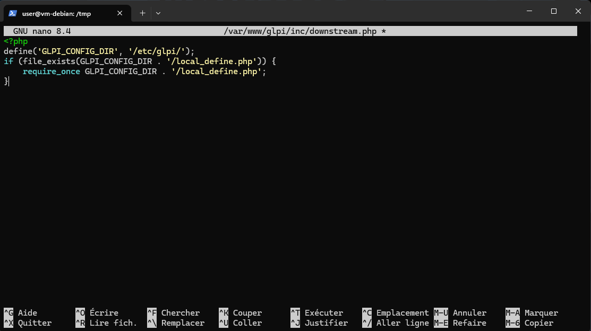
  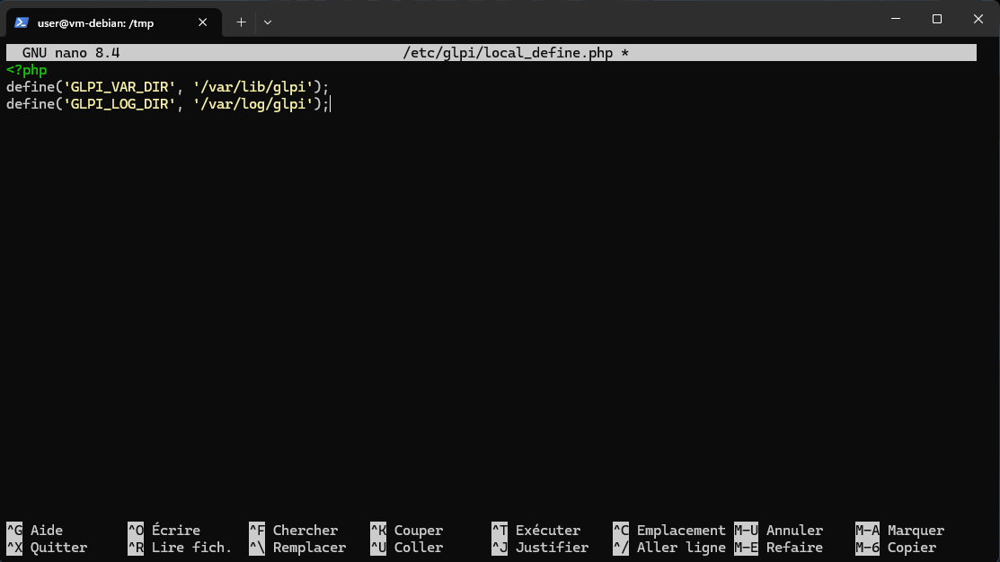
</p>

### Hôte virtuel Apache

Fichier [`Config/apache/glpi.conf`](./Config/apache/glpi.conf) : seul le dossier `public` est exposé, et toutes les requêtes passent par `index.php`, le routeur de GLPI. Le code et les fichiers sensibles ne sont jamais accessibles directement depuis le navigateur.

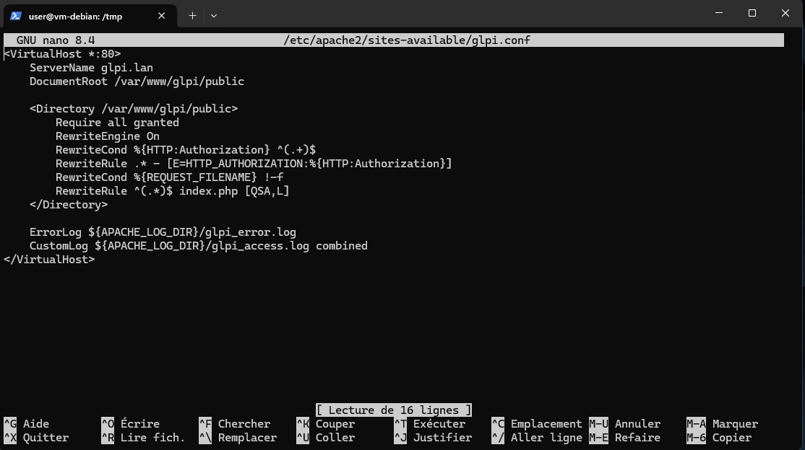

```bash
sudo sed -i 's/^;\?session.cookie_httponly =.*/session.cookie_httponly = On/' /etc/php/8.4/apache2/php.ini
sudo a2enmod rewrite
sudo a2dissite 000-default
sudo a2ensite glpi
sudo apache2ctl configtest
sudo systemctl restart apache2
```

| Commande | Rôle |
| --- | --- |
| `session.cookie_httponly = On` | Le cookie de session n'est pas lisible par JavaScript (protection contre le vol de session par XSS) |
| `a2enmod rewrite` | Active la réécriture d'URL nécessaire au routeur de GLPI |
| `a2dissite` / `a2ensite` | Remplace le site par défaut d'Apache par celui de GLPI |
| `apache2ctl configtest` | Vérifie la syntaxe avant le redémarrage |

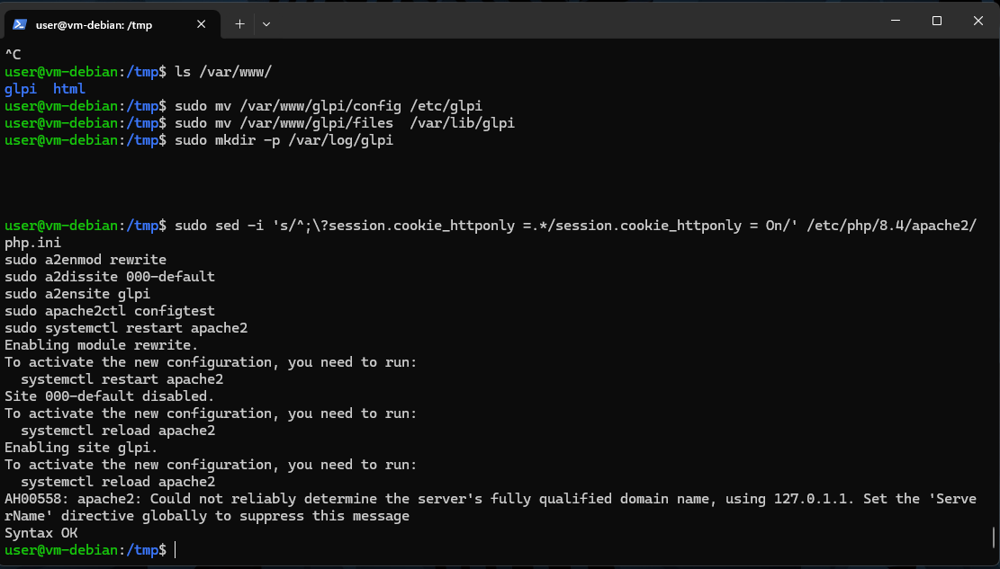

### Assistant d'installation

<p align="center">
  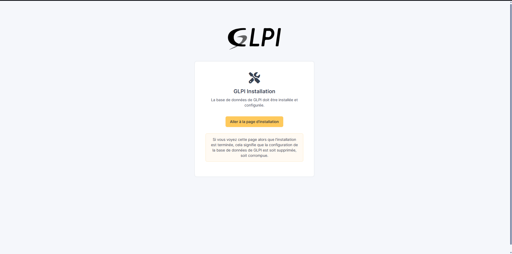
  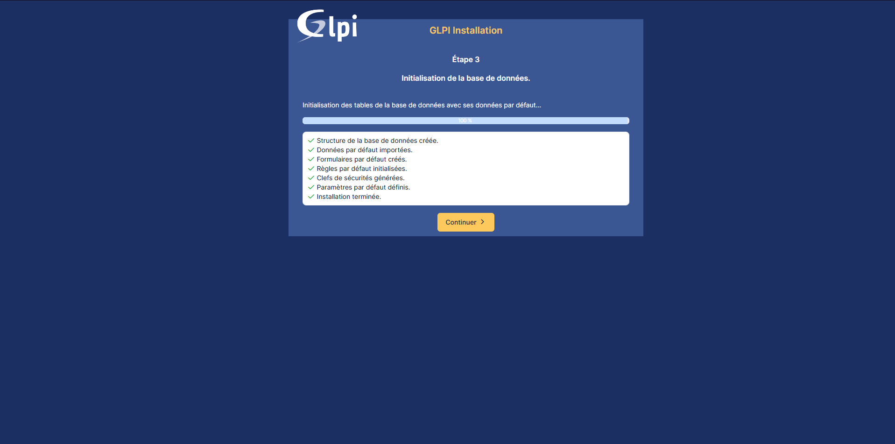
  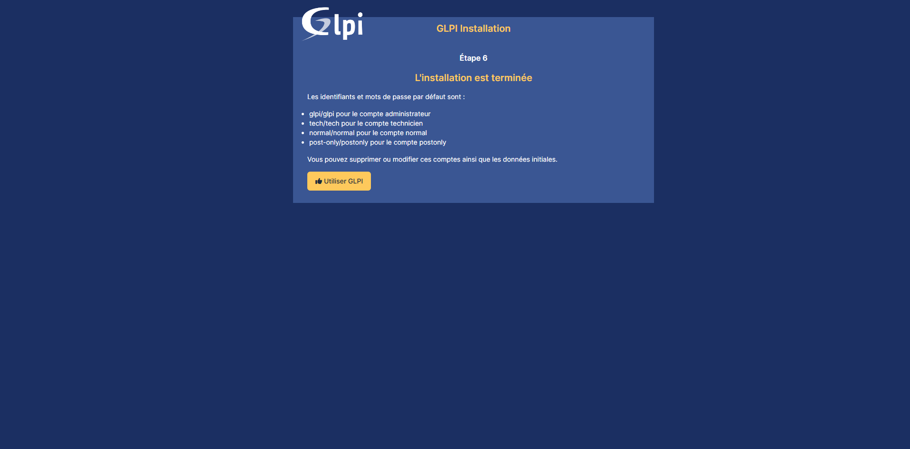
</p>

Après l'installation, le script d'installation est supprimé et les mots de passe des quatre comptes par défaut (`glpi`, `tech`, `normal`, `post-only`) sont modifiés :

```bash
sudo rm /var/www/glpi/install/install.php
```

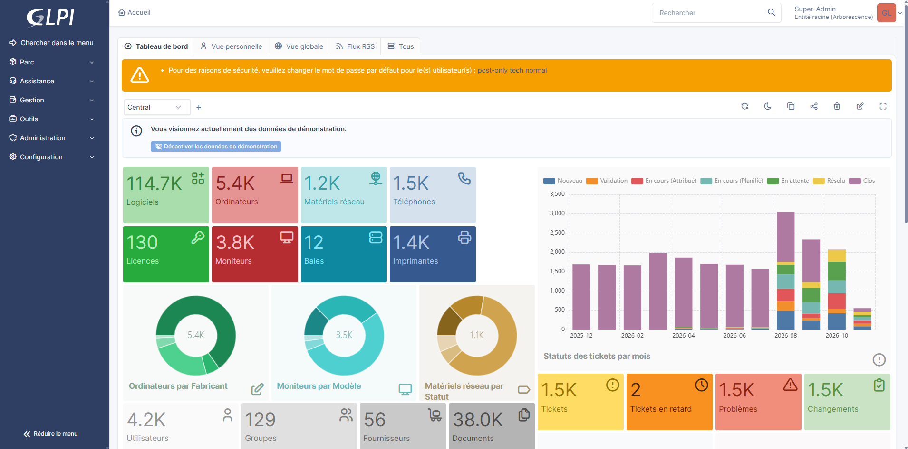

---

## 5. Beszel — supervision

Beszel se compose d'un **Hub**, l'interface web qui conserve l'historique et affiche les graphiques, et d'un **Agent**, qui mesure l'état de la machine et transmet les données au Hub.

```bash
curl -sL https://get.beszel.dev/hub -o /tmp/install-hub.sh
chmod +x /tmp/install-hub.sh
sudo /tmp/install-hub.sh
```

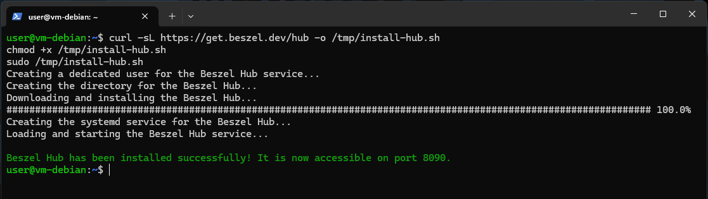

Après la création du compte administrateur sur `http://192.168.91.134:8090`, l'ajout du système génère la commande d'installation de l'agent, avec la clé publique du Hub et un jeton d'enregistrement :

```bash
curl -sL https://get.beszel.dev -o /tmp/install-agent.sh
sudo chmod +x /tmp/install-agent.sh
sudo /tmp/install-agent.sh -p 45876 -k "<clé publique du hub>" -t "<token>" -url "http://192.168.91.134:8090"
systemctl status beszel-agent --no-pager
```

L'agent s'exécute sous un compte système dédié `beszel`, sans privilèges root.

<p align="center">
  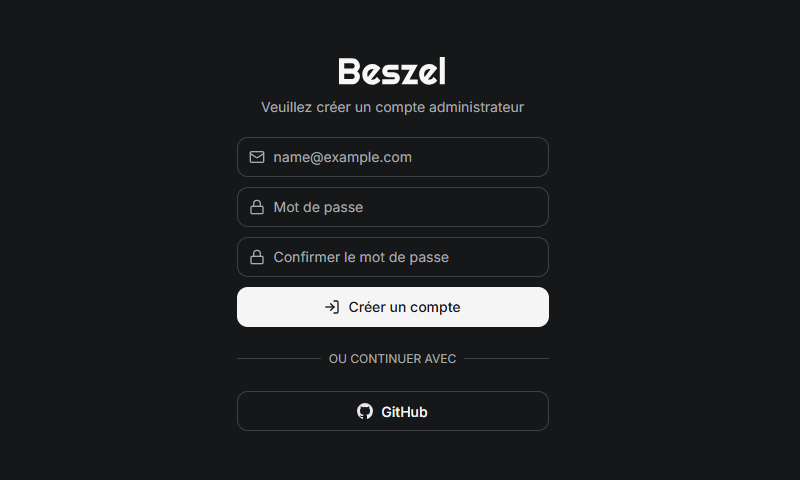
  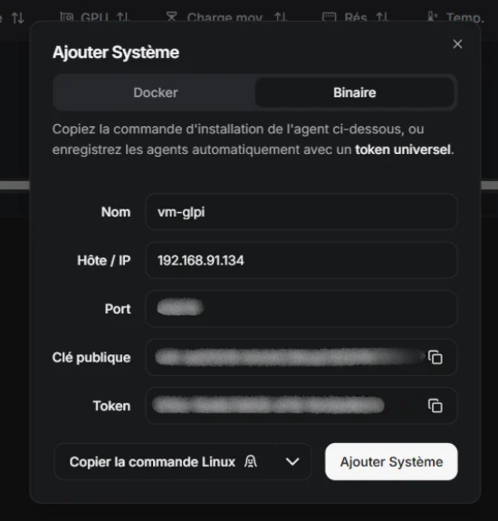
</p>

Une fois l'agent installé, le système apparaît en ligne dans le tableau de bord avec ses métriques en temps réel :

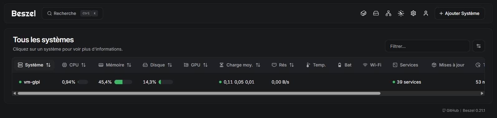

---

## 6. Sauvegarde automatisée

La sauvegarde repose sur quatre scripts Bash, chacun chargé d'une tâche, disponibles dans [`Scripts/sauvegarde/`](./Scripts/sauvegarde/). Ils sont installés dans `/root/scripts/` et s'exécutent en root.

| Script | Rôle |
| --- | --- |
| [`backupGLPI.sh`](./Scripts/sauvegarde/backupGLPI.sh) | Script principal lancé par cron : calcule une date unique, enchaîne les trois étapes, supprime les archives locales de plus de 7 jours |
| [`dumpsql.sh`](./Scripts/sauvegarde/dumpsql.sh) | Export de la base `glpi` avec `mariadb-dump --single-transaction`, sans bloquer l'application et sans mot de passe en clair (socket Unix) |
| [`targz.sh`](./Scripts/sauvegarde/targz.sh) | Archive compressée de `/etc/glpi`, `/var/lib/glpi` et du dump SQL, dossiers temporaires exclus |
| [`sendftp.sh`](./Scripts/sauvegarde/sendftp.sh) | Contrôle de la limite de 10 Mo d'InfinityFree, puis envoi en FTP passif et en mode binaire |
| [`restauration.sh`](./Scripts/sauvegarde/restauration.sh) | Restauration complète d'une archive : fichiers, base de données et droits |

```
backupGLPI.sh
   ├── 1. dumpsql.sh   →  /tmp/<date>_glpi.sql
   ├── 2. targz.sh     →  /root/backups/<date>_glpi.tar.gz
   ├── 3. sendftp.sh   →  ftpupload.net:/backups/
   └── rotation locale (7 jours)
```

### Installation

```bash
sudo -i
apt install -y ftp
mkdir -p /root/scripts /root/backups
cp Scripts/sauvegarde/*.sh /root/scripts/
nano /root/scripts/sendftp.sh        # renseigner les identifiants FTP
chmod 700 /root/scripts/*.sh
/root/scripts/backupGLPI.sh
```

`chmod 700` rend les scripts lisibles et exécutables par root uniquement, car `sendftp.sh` contient les identifiants FTP.

### Résultat de l'exécution

```
*1* DUMPSQL de la base GLPI ***
*2* Archivage de GLPI ***
*** Dépôt dans /root/backups/ : 116K ***
*3* Envoi de l'archive sur le FTP InfinityFree ***
Connected to ftpupload.net.
230 OK. Current restricted directory is /
200 TYPE is now 8-bit binary
550 Can't create directory: File exists
250 OK. Current directory is /backups
227 Entering Passive Mode
150 Accepted data connection
226-File successfully transferred
221 Logout.
```

| Code FTP | Signification |
| --- | --- |
| `230` | Authentification réussie |
| `227` | Passage en mode passif |
| `226` | Transfert terminé avec succès |
| `550` | Dossier `backups` déjà existant (sans conséquence) |

Le dossier `backups` est situé à la racine du compte FTP, **en dehors de `htdocs`** : les archives ne sont pas accessibles publiquement depuis le site web.

---

## 7. Planification avec crontab

```bash
crontab -e
```

```
0 3 * * * /root/scripts/backupGLPI.sh >> /var/log/backupGLPI.log 2>&1
```

| Champ | `0` | `3` | `*` | `*` | `*` |
| --- | --- | --- | --- | --- | --- |
| **Signification** | minute 0 | 3 h | tous les jours du mois | tous les mois | tous les jours de la semaine |

La sauvegarde s'exécute **chaque nuit à 3 h 00**. `>>` ajoute la sortie au journal `/var/log/backupGLPI.log` et `2>&1` y inclut les erreurs.

```bash
crontab -l
tail -20 /var/log/backupGLPI.log
```

### Restauration

```bash
/root/scripts/restauration.sh /root/backups/<date>_glpi.tar.gz
```

---

## Vérifications

| Service | Commande / contrôle | Résultat attendu |
| --- | --- | --- |
| **SSH** | `sudo sshd -T` · `ssh root@192.168.91.134` | `permitrootlogin no`, `passwordauthentication no`, connexion root refusée |
| **Fail2Ban** | `sudo fail2ban-client status sshd` · `sudo nft list ruleset` | Échecs comptabilisés, IP bannie, règle `reject` sur le port 22 |
| **GLPI** | `http://192.168.91.134` | Tableau de bord sans alerte de sécurité |
| **Beszel** | `http://192.168.91.134:8090` | Système au vert, métriques en temps réel |
| **Sauvegarde** | `crontab -l` · `/var/log/backupGLPI.log` | `226 File successfully transferred`, archive présente sur InfinityFree |

---

## Sécurité

| Mesure | Mise en œuvre |
| --- | --- |
| **Authentification forte** | Authentification par clé, mots de passe SSH désactivés |
| **Moindre privilège** | Root interdit en SSH, `sudo`, utilisateur MariaDB limité à sa base, agent Beszel non root |
| **Défense contre le brute-force** | Fail2Ban + nftables |
| **Cloisonnement de l'application** | Seul `/var/www/glpi/public` est exposé, configuration et données hors du web |
| **Sessions web** | Cookie de session `HttpOnly` |
| **Réduction de la surface d'attaque** | Installation minimale, site Apache par défaut désactivé, script d'installation GLPI supprimé |
| **Continuité** | Sauvegarde quotidienne hors site, rotation locale, script de restauration |
| **Secrets** | Aucun identifiant réel dans ce dépôt : valeurs remplacées par des marqueurs `CHANGER_MOT_DE_PASSE` / `<token>` |

---

## Difficultés rencontrées

**Absence d'adresse IP.** En mode pont, la carte virtuelle était reliée à une mauvaise interface physique : la VM recevait une adresse auto-attribuée en `169.254.x.x` et n'avait pas accès à Internet. Le passage en **NAT** puis le renouvellement du bail (`dhcpcd ens33`) ont résolu le problème.

**Fail2Ban ne détectait aucun échec.** Sous Debian 13, OpenSSH 10 sépare les sessions dans un processus `sshd-session`. Le filtre par défaut, limité au processus `sshd`, ne voyait donc aucune tentative. L'ajout de `journalmatch = _SYSTEMD_UNIT=ssh.service` a rétabli la détection.

**Limite de taille d'InfinityFree.** L'hébergement refuse tout fichier de plus de 10 Mo. Le script fourni archivait l'intégralité du code de GLPI : la sauvegarde a été recentrée sur la base, la configuration et les données (environ 116 Ko), et un contrôle de taille a été ajouté avant l'envoi.

**Scripts et cron.** Les scripts s'appelaient par un chemin relatif, ce qui échoue sous cron. L'ajout de `cd "$(dirname "$0")"` garantit leur exécution quel que soit le répertoire courant.

---

## Perspectives d'évolution

- **HTTPS sur GLPI** — certificat (autorité interne ou Let's Encrypt) et redirection automatique du port 80 vers 443
- **Pare-feu restrictif** — politique nftables par défaut en refus, n'ouvrant que les ports 22, 80/443 et 8090
- **Chiffrement des sauvegardes** — chiffrement GPG des archives avant leur envoi, et passage à un transfert chiffré (FTPS/SFTP)
- **Alertes Beszel** — notifications en cas de disque plein, de charge élevée ou de serveur hors ligne
- **Agent d'inventaire GLPI** — inventaire automatique des postes du parc
- **Redéploiement sur Proxmox VE** — migration de la VM sur l'hyperviseur, avec sauvegardes natives vzdump

---

## Arborescence du dépôt

```
Serveur-BTS-2026/
├── Config/
│   ├── apache/glpi.conf              # Hôte virtuel Apache de GLPI
│   ├── fail2ban/jail.local           # Jail sshd
│   ├── glpi/
│   │   ├── creation-base.sql         # Base et utilisateur MariaDB
│   │   ├── downstream.php            # Emplacement de la configuration
│   │   └── local_define.php          # Emplacement des données et journaux
│   └── ssh/99-hardening.conf         # Durcissement OpenSSH
├── Documentation/
│   └── Procedure-installation.pdf    # Procédure complète commentée (3 pages)
├── Images/                           # Bannière, architecture et captures
├── Scripts/
│   └── sauvegarde/
│       ├── backupGLPI.sh             # Script principal (cron)
│       ├── dumpsql.sh                # Export de la base
│       ├── targz.sh                  # Création de l'archive
│       ├── sendftp.sh                # Envoi FTP vers InfinityFree
│       ├── restauration.sh           # Restauration d'une archive
│       └── crontab.txt               # Planification
└── README.md
```

---

## Conclusion

Ce projet aboutit à un serveur Debian 13 opérationnel et sécurisé, hébergeant GLPI, supervisé en temps réel et sauvegardé automatiquement chaque nuit hors site.

Ce projet a permis :

- de durcir un accès SSH en remplaçant les mots de passe par une authentification par clé et en restreignant les comptes autorisés
- de mettre en place une détection d'intrusion avec Fail2Ban et de comprendre son interaction avec systemd et nftables
- de déployer une application web métier sur une pile LAMP en appliquant les recommandations de sécurité de l'éditeur
- d'installer une solution de supervision et d'en lire les indicateurs
- d'automatiser une sauvegarde complète et restaurable avec Bash et cron, en tenant compte des contraintes d'un hébergement distant
- de diagnostiquer et corriger des problèmes réels : réseau virtuel, journalisation d'OpenSSH 10, limites d'hébergement

---

*Réalisé par [Yacine Harrache](https://github.com/yacinehrc) — Étudiant en 2ème année | EPSI Lille*
